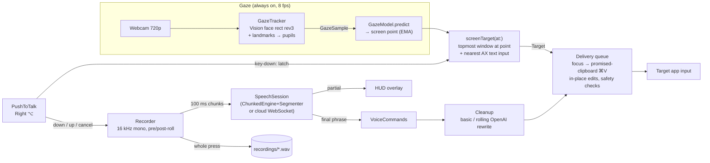

# Architecture

A-EYE is a single-process AppKit app with no windows (`LSUIElement`, activation policy
`.accessory`). `AppDelegate` wires everything together. All screen coordinates in the code
are **global, top-left origin**, the same space AX and CGWindowList use. AppKit's
bottom-left coordinates only appear when drawing panels (`AX.toCocoa`).

## Components

### GazeTracker (`GazeTracker.swift`)

- Uses AVCaptureSession at `.hd1280x720` and throttles the camera to **8 fps**. The frame
  duration is set *after* `startRunning`, because presets reset it on start. The delegate
  also drops frames that arrive early.
- `VNDetectFaceRectanglesRequest` revision 3 gives yaw and pitch. From the largest face it
  takes the face centre (`faceX/Y`) and width (`faceSize`).
- `VNDetectFaceLandmarksRequest` rev3 runs only on the face it already found
  (`inputFaceObservations`), so there's no second detection pass. It produces the **pupil
  offset from the eye-outline centroid in eye-widths**, averaged over both eyes. During a
  blink (eye height/width ≤ 0.12) the last pupil value is held.
- Every signal is smoothed with an EMA (α = 0.5). The output is a `GazeSample`, delivered
  on the main queue (`nil` means no face).
- `frameTap` hands the raw pixel buffer and face box to `GazeRecorder` when you record a
  test set.

### GazeModel and calibration (`ScreenGaze.swift`)

- `GazeModel.predict(sample)` turns a sample into a global screen point. `AppDelegate`
  smooths that point again with an EMA (α = 0.5) and clamps it onto the nearest display.
- `ScreenCalibrator` runs the 6-phase onboarding. It keeps the raw calibration points so
  that *Add a posture* can append to them and refit.
- The model is stored in `gaze-model-v3.json` and the raw points in
  `gaze-calibration-v3.json`.
- The details are in [gaze.md](gaze.md).
- If no screen calibration exists, the app falls back to the original **pinned targets**
  mode (`Targets.swift`). There, `GazeClassifier` does nearest-centroid classification over
  head yaw and pitch per registered window/pane. It uses 2° hysteresis and needs 3 frames
  before switching.

### Target selection (`AppDelegate.screenTarget`, `WindowControl.swift`)

- `WindowControl.window(at:)` walks `CGWindowListCopyWindowInfo` front-to-back. It looks
  for the first layer-0 window that isn't A-EYE's and that contains the point, then matches
  it to an AX window by frame (tolerance 40). Pid and bounds don't need Screen Recording
  permission.
- `nearestInput(to:in:)` walks upward from the AX element under the point, looking for
  `AXTextArea`/`AXTextField` elements, then falls back to a bounded breadth-first search of
  the whole window. In screen mode it accepts inputs up to 500 pt away.
- The input's centre is stored as a `clickFraction` of the window, which makes the `Target`
  resilient to the input moving. `Target.key` (bundle + window frame + coarse click
  position) identifies "the same box" across presses.
- `AX.enableElectronTree` sets `AXManualAccessibility` on every regular app at launch and
  on every newly launched app. Without it, Electron windows expose no children.

### PushToTalk (`PushToTalk.swift`)

- Uses global and local `flagsChanged` monitors for key code 61 (Right ⌥). These need
  Accessibility. Monitors registered before trust is granted never fire, so `AppDelegate`
  polls every 1.5 s and re-registers once trust arrives.
- A hold shorter than 0.25 s, Esc, or any key within 0.4 s of pressing triggers `onCancel`.

### Recorder (`Recorder.swift`, `AudioDevices.swift`)

- `AVAudioEngine` taps the input at the **hardware format** and converts it to 16 kHz mono
  Float32.
- A 0.5 s ring buffer provides **pre-roll**. On release, recording continues for 0.35 s of
  **post-roll** so the last word isn't clipped. If a new press starts during post-roll,
  the previous press is closed immediately.
- The engine stays warm for `micWarmSeconds` (20 s by default) after a press, so the next
  press starts instantly with pre-roll.
- `AudioDevices.preferredInput()` picks the built-in mic when the default input is
  Bluetooth, so AirPods stay in A2DP instead of switching to HFP.
- Every 100 ms, `AppDelegate.pumpAudio` feeds new samples to the session. On key-up, the
  whole press is written to `recordings/<stamp>.wav` *before* the session is finished.

### Speech engines (`Engines.swift`, `Transcriber.swift`, `Parakeet.swift`, `CloudEngines.swift`)

- `SpeechEngine` → one `SpeechSession` per press. A session takes `append(samples)`,
  `finish()` and `cancel()`, and emits `.partial` (shown only), `.final` (pasted), `.failed`
  and `.done` on the main queue.
- `ChunkedEngine` adapts any clip transcriber (Parakeet, Whisper, Wispr Flow, Apple) into a
  streaming session. It uses `Segmenter` pause detection: each phrase is transcribed in
  order, and live partials are re-run every 0.5 s for engines fast enough
  (`livePartials`: Parakeet).
- Deepgram and OpenAI stream natively over WebSocket.
- If a cloud engine fails before producing any text, the saved WAV is transcribed with
  `Engines.localTranscriber()`.
- See [speech.md](speech.md).

### Press handling (`AppDelegate.handle`, `completePressAsync`)

- `Press` (`Dispatcher.swift`) is the per-press record: target, text, phrase count,
  submit flag, clean-up tasks, rolling-rewrite state, WAV and error.
- In paste-while-speaking mode, each `.final` phrase is run through `VoiceCommands` and
  then pasted. In paste-on-release mode, the phrases are concatenated and interpreted
  once, in `completePressAsync`.
- `completePressAsync` is pinned to `@MainActor`. It waits for rewrites to settle
  (`settleRewrites`), queues Return if requested, and appends the press to `history.jsonl`.

### VoiceCommands (`VoiceCommands.swift`)

Parses "scratch that" / "clear the input" / "send it" out of raw engine text (before
clean-up, so the commands can't be tidied away). See [speech.md](speech.md#voice-commands).

### Cleanup (`Cleanup.swift`)

- `basic` is regex filler and stutter removal.
- `rewrite` is the rolling OpenAI rewrite of the whole press so far, with length-ratio
  guards.
- `warm()` pre-opens the HTTPS connection on key-down.

### Delivery (`Dispatcher.swift`, `WindowControl.swift` › `Input`)

- A single serial job queue on the main actor. Jobs are `.text`, `.rewrite`,
  `.undoLast`, `.clear` and `.submit`.
- **Focus:** `WindowControl.focus` raises the target window, then focuses the nearest
  input via AX (clicking it only if the AX focus didn't take). The focus step is skipped
  if A-EYE focused that target last and nothing has changed since. If the target window
  can't be resolved (closed, or on another Space), the text is **copied to the clipboard,
  never pasted into whatever is in front**.
- **Segments:** every piece of text pasted into the current box is recorded, so later
  edits (rewrite, scratch) can backspace over exactly A-EYE's own text. Segments are
  dropped when you click (non-synthetic mouse-down) or type yourself.
- **Safety check:** before any blind ⌫ edit, `boxEndsWith` reads the focused element's
  `AXValue` and requires it to end with the text A-EYE thinks it typed. If it doesn't, the
  edit is skipped. Segment indices are looked up again after every `await`.
- **Paste:** `Input.paste` *promises* the text on the pasteboard (an `NSPasteboardItem`
  data provider), sends ⌘V from a private event source with explicit flags (so the held
  Right ⌥ doesn't leak in), waits until the app has actually read the data (up to 1.5 s),
  then restores the previous clipboard.
- **Hop-back:** if you're already recording for another target while a job is delivered,
  focus returns to that target afterwards.

### HUD and overlays (`HUD.swift`, `ScreenGaze.swift`)

Non-activating `NSPanel`s: the status pill, the target highlight, the calibration dot and
the gaze pointer. They must only be touched on the main thread (see
[development.md](development.md#gotchas)).

### Persistence (`Support.swift`, `Keychain.swift`)

`Paths` (under `~/Library/Application Support/A-EYE`), `Settings` (UserDefaults), `Log`
(`~/Library/Logs/A-EYE.log`) and the `Keychain` wrapper. See
[development.md](development.md#data-locations).
